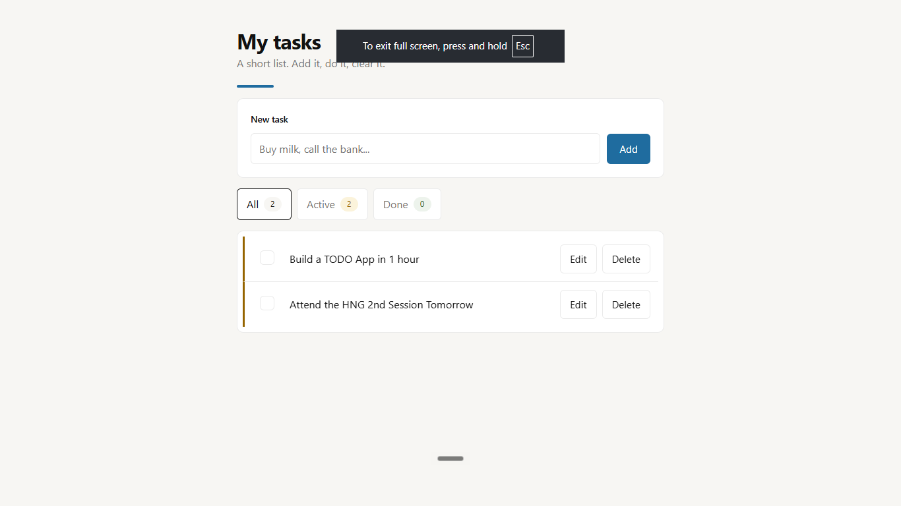

# My Tasks — Flask To-Do App

A simple server-rendered to-do app: add, complete, edit, and delete tasks,
with All / Active / Done filters. Built with Flask, Jinja, plain CSS, and
SQLite. No JavaScript framework.



## Quick start

```bash
copy .env.example .env   # Windows (once, to set your SECRET_KEY)
uv sync                  # create .venv + install deps
uv run python app.py     # serve at http://127.0.0.1:5000
```

## Commands

```bash
uv run pytest -q    # tests
uv run ruff check . # lint
```

After changing dependencies, regenerate the Vercel file:

```bash
uv export --no-dev --format requirements-txt --no-hashes > requirements.txt
```

## How it works

- `app.py` — routes only: read the form, call `db.py`, flash a message, redirect.
- `db.py` — all SQLite code in one module (path, connect, init, CRUD, counts).
  Uses `TODO_DB_PATH` if set, `/tmp/todo.db` on Vercel, otherwise `todo.db`.
- `forms.py` — Flask-WTF forms with CSRF protection and validation.
- `templates/` + `static/style.css` — Jinja pages, plain responsive CSS.

## Deploy

```bash
vercel --prod
```

Set `SECRET_KEY` in the Vercel project environment first, or form posts
will fail. Note: serverless SQLite is per-instance and temporary, so saved
tasks reset between deploys. That is expected for this demo.
